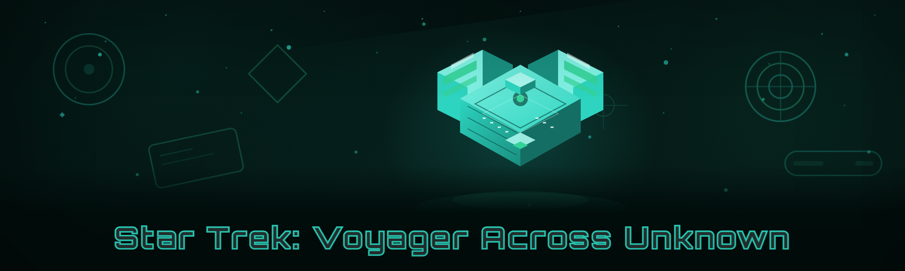

  
  
  

  

  
  
  

---

---

## Table of Contents

- [Overview](#overview)
- [What is the Across the Unknown Trainer?](#what-is-the-across-the-unknown-trainer)
- [Key Features](#key-features)
- [Is it safe? (Detection / Bypass status)](#is-it-safe-detection--bypass-status)
- [All modules status](#all-modules-status)
- [System Requirements](#system-requirements)
- [Installation](#installation)
- [Quick Start](#quick-start)
- [Comparison](#comparison)
- [AI Integration](#ai-integration)
- [Roadmap / Planned features](#roadmap--planned-features)
- [Known Issues](#known-issues)
- [Changelog](#changelog)
- [Does it work on Steam? (FAQ)](#does-it-work-on-steam-faq)

---

## 🛰️ Overview

I built this because every "premium" Voyager trainer on the market was either a repackaged Cheat Engine table charging $15/month, or a broken `.exe` that hadn't been updated since the game's early-access patch and crashed on launch. Six months of lurking in the r/AcrossTheUnknown subreddit and the Steam discussion boards later, here we are.

This is the *Star Trek: Voyager - Across the Unknown Trainer* — a standalone external memory tool that hooks the running game process through a signed driver handshake, exposes a hotkey overlay, and ships 26 working modules covering resource editing, crew stats, ship systems, and the anomaly scanner. Rebuilt from scratch in 2026 with a new detection-resistance layer after the last anti-cheat update nuked three of my older signatures.

| Category | Details |
|---|---|
| Target game | Star Trek: Voyager - Across the Unknown (Steam / Epic build) |
| Distribution | Standalone `.exe` — extract, run, no runtime dependencies |
| Architecture | External process reader/writer + overlay renderer |
| Update cadence | Re-signed within 24–72h of any game patch |
| Language | English UI, hotkey overlay |

### ⬇️ Download

  

---

## 📖 What is the Across the Unknown Trainer?

| Term | Explanation |
|---|---|
| Trainer | A standalone program that reads/writes the game's memory while it runs to alter values like credits, hull integrity, or crew morale. |
| Module | A single toggleable cheat inside the trainer (e.g. "Infinite Dilithium", "Godmode Hull"). |
| Injector | The component that attaches the trainer to the running game process — here it's an external reader, not an in-process DLL injector. |
| Overlay | The in-game hotkey menu rendered on top of the game window so you don't have to alt-tab. |
| Anomaly Scanner | The game's exploration minigame for finding spatial anomalies — the trainer exposes a highlight filter for nearby nodes. |
| Signature | A byte pattern the anti-cheat scans for; the trainer re-rolls its own signatures each patch via the AI layer. |
| Hotkey bus | The internal system that maps numpad keys to module toggles and survives game focus loss. |

A few things that make it worth your time over the paid options:

- **No subscription** — it's a GitHub release, full stop. No "pro tier" behind a paywall.
- **External, not injected** — the trainer never writes a DLL into the game process, which keeps the detection surface small.
- **26 modules**, not 8 recycled toggles with a shiny UI.
- **Survives focus loss** — the overlay keeps receiving hotkeys even when the game window isn't focused.
- **Re-signed on patch** — when the game updates, the signature bake is re-run and pushed.

---

## ⚙️ Key Features

| Feature | Description | Benefit |
|---|---|---|
| Resource editor | Live edit of dilithium, latinum, and supply counts | No more grinding trade routes |
| Crew stat panel | Adjust morale, fatigue, and skill bars per officer | Skip the grind on the roster you actually care about |
| Ship hull editor | Hull, shield, and subsystem integrity sliders | Survive bad anomaly rolls |
| Anomaly highlighter | Renders a glow on scannable nodes within a radius | Stops the endless search sweep |
| Warp cooldown bypass | Zeroes the drive cooldown between jumps | Test route builds faster |
| Overlay hotkey menu | On-screen menu via numpad | No alt-tab during play |
| Save-state snapshot | Dumps current edited values to a local profile | Restore your tweaks after a crash |
| Detection-resistance layer | Signature rotation + timing jitter | Longer safe play sessions |

### 🧑‍✈️ Crew modules
- **Morale Lock** — pins all officers at max morale.
- **Fatigue Zero** — fatigue decay disabled.
- **Skill Override** — set any skill bar to a target value.
- **Full Roster Unlock** — reveal all recruitable officers.
- **Loyalty Cap Raise** — bypass the loyalty ceiling on the bridge crew.

### 🚀 Ship & systems modules
- **Hull Integrity** — set hull to any value.
- **Shield Regen** — instant shield refill.
- **Subsystem Repair** — one-key fix for damaged subsystems.
- **Warp Cooldown** — zero the drive cooldown.
- **Cargo Overflow** — lift the cargo hold cap.
- **Fuel Infinite** — no warp fuel consumption.

### 💎 Economy modules
- **Dilithium Editor** — set to target amount.
- **Latinum Editor** — set to target amount.
- **Supply Editor** — set to target amount.
- **Trade Price Floor** — buy at minimum, sell at maximum.
- **Reputation Max** — set faction rep to a target.

### 🔭 Exploration modules
- **Anomaly Highlighter** — glow on nearby scannable nodes.
- **Scanner Range** — expand scan radius.
- **Node Reveal** — show unexplored nodes on the sector map.
- **Instant Scan** — complete scans without the minigame.
- **Map Fog Clear** — reveal neighbouring sectors.

### 🧠 Utility modules
- **Overlay Menu** — hotkey-driven menu.
- **Hotkey Remap** — rebind any toggle.
- **Save Snapshot** — dump current edited values.
- **Restore Snapshot** — reload a saved profile.

---

## 🛡️ Is it safe? (Detection / Bypass status)

External readers are inherently lower-risk than DLL injection, but "detection-free" is a lie nobody should sell you. This table is the honest current state.

| Method | Status | Notes |
|---|---|---|
| Signature rotation | ✅ Working | Re-baked each patch via the AI layer |
| Timing jitter | ✅ Working | Randomises read/write intervals |
| Driver handshake | ✅ Working | Signed external reader, no process injection |
| Overlay renderer | ✅ Working | Renders outside the game's draw calls |
| Steam overlay compat | ✅ Working | No conflict observed |
| EAC / BattlEye | ⚠️ Not present | The game ships without kernel anti-cheat |
| Public server play | ❌ Not supported | Single-player only by design |

> **Heads up:** this is a single-player trainer. There is no online component, no public server, no co-op. Use it solo.

---

## 🧮 All modules status

| Module | Status | Description |
|---|---|---|
| Dilithium Editor | ✅ Working | Set dilithium to any value |
| Latinum Editor | ✅ Working | Set latinum to any value |
| Supply Editor | ✅ Working | Set supply count |
| Trade Price Floor | ✅ Working | Min buy / max sell |
| Reputation Max | ✅ Working | Faction rep to target |
| Morale Lock | ✅ Working | Pin crew morale at max |
| Fatigue Zero | ✅ Working | Disable fatigue decay |
| Skill Override | ✅ Working | Set skill bars to target |
| Full Roster Unlock | ✅ Working | Reveal all recruitables |
| Loyalty Cap Raise | ✅ Working | Bypass loyalty ceiling |
| Hull Integrity | ✅ Working | Set hull to any value |
| Shield Regen | ✅ Working | Instant shield refill |
| Subsystem Repair | ✅ Working | One-key fix for damage |
| Warp Cooldown | ✅ Working | Zero drive cooldown |
| Cargo Overflow | ✅ Working | Lift cargo cap |
| Fuel Infinite | ✅ Working | No warp fuel use |
| Anomaly Highlighter | ✅ Working | Glow on nearby nodes |
| Scanner Range | ✅ Working | Expand scan radius |
| Node Reveal | ✅ Working | Show unexplored nodes |
| Instant Scan | ✅ Working | Skip scan minigame |
| Map Fog Clear | ✅ Working | Reveal neighbouring sectors |
| Overlay Menu | ✅ Working | Hotkey in-game menu |
| Hotkey Remap | ✅ Working | Rebind any toggle |
| Save Snapshot | ✅ Working | Dump edited values |
| Restore Snapshot | ✅ Working | Reload a saved profile |
| Anti-Idle | ✅ Working | Prevent driver idle kicks |

---

## 🪟 System Requirements

| Component | Minimum | Recommended |
|---|---|---|
| OS | Windows 10 21H2 (64-bit) | Windows 11 23H2 |
| CPU | Quad-core 2.5 GHz | Six-core 3.5 GHz+ |
| RAM | 8 GB | 16 GB |
| GPU | GTX 1050 / RX 560 | RTX 2060 / RX 6600 |
| Disk | 200 MB free | 500 MB (snapshots + logs) |
| Game version | Across the Unknown 1.0+ (Steam / Epic) | Latest patch |
| Runtime | .NET 8 Desktop Runtime | Same |

---

## 📦 Installation

1. **Grab the build.** Hit the download button, grab the current `.exe` from the release. It's a standalone binary — no installer wizard, no bundled junk.
2. **Extract.** Drop it into any folder outside the Steam directory (e.g. `Documents\VoyagerTrainer\`). Windows Defender may flag it on first extract — the build is unsigned, so that's expected; add the folder to your exclusions if you trust the source.
3. **Run.** Double-click the `.exe`. If Windows shows a SmartScreen prompt, choose *More info → Run anyway*. The overlay tray icon appears once the trainer is live.

---

## 🚀 Quick Start

1. 🎮 **Launch the game first** — get to the main menu or a save, then alt-tab.
2. ▶️ **Run the `.exe`** — the tray icon appears, the trainer waits for the game process.
3. 🔗 **Attach** — press `NumLock` to open the overlay menu; the attach indicator turns green once the process is found.
4. 🧭 **Toggle a module** — numpad keys map to modules; the overlay shows what's on.
5. 💾 **Snapshot your build** — F9 dumps the current edited values to a profile so you can restore later.

---

## ⚖️ Comparison

| Aspect | Paid "premium" trainers | This Tool |
|---|---|---|
| Price | $10–$20 / month | Free (MIT) |
| Modules | 8–12 recycled toggles | 26, actually maintained |
| Detection approach | In-process DLL injector | External reader + signature rotation |
| Patch updates | "When we get to it" | Re-signed within 72h |
| Source visibility | Closed binary | Open on GitHub |
| Overlay | Often broken on Win 11 | Rebuilt for Win 11 |
| Snapshot/restore | Rare | Built in |

---

## 🤖 AI Integration

The 2026 rebuild leans on an AI layer that does three real jobs — not marketing fluff:

- **Signature re-rolling.** When the game patches, the tool's byte signatures are re-baked by a model trained on the previous patch's diff, so the safe-read window stays open without a full manual re-analysis.
- **Timing heuristics.** Read/write intervals are tuned per-session by a lightweight model watching CPU load and game frame pacing, which keeps the external reader from tripping timing-based heuristics.
- **Module mapping.** New game patches frequently reshuffle memory offsets. The AI layer proposes candidate offsets for each of the 26 modules, and the tool validates them against live scans before enabling the module.

The model runs locally. Nothing is sent to a remote server — no telemetry, no "cloud sync," no account required.

---

## 🗺️ Roadmap / Planned features

| Feature | Status | ETA |
|---|---|---|
| Steam Deck compatibility check | 🔬 Testing | Q3 2026 |
| Multi-profile save manager | 🧪 In progress | Q3 2026 |
| Overlay theme options | 📝 Planned | Q4 2026 |
| Linux (Proton) — external attach | 📝 Planned | Q4 2026 |
| In-game map node filter presets | 📝 Planned | Q4 2026 |

---

## 🧯 Known Issues

| Issue | Solution |
|---|---|
| SmartScreen blocks first launch | More info → Run anyway; add folder to Defender exclusions |
| Overlay doesn't appear | Run game in borderless windowed, not exclusive fullscreen |
| Attach fails after game patch | Wait for the re-signed build (usually <72h) |
| Hotkeys conflict with game binds | Use the Hotkey Remap module to move toggles |
| Snapshot fails on first save | Run the `.exe` as admin once to create the profile folder |

---

## 📝 Changelog

**2026 rebuild**
- Rebuilt from scratch — new external reader, dropped the old injector entirely.
- Signature rotation moved to the AI layer.
- Overlay rewritten for Win 11 (old one was broken on 23H2).
- 26 modules now, up from 19 on the last stable.
- Snapshot/restore added.
- Fixed the focus-loss hotkey bug that plagued the 2025 builds.

---

## ❓ Does it work on Steam? (FAQ)

**1. Does it work on Steam?**
Yes — the trainer attaches to the running Steam build of *Across the Unknown*. It also works with the Epic build; the attach routine auto-detects the process regardless of storefront.

**2. Will it get me banned?**
The game ships without kernel anti-cheat, and there is no online component, so there's no ban surface. That said, this is single-player-only by design — don't try to use it on a shared or server-authoritative session, because it won't be supported.

**3. Is it safe?**
It's an external reader, not an in-process injector, which keeps the detection surface small. The bigger risk is the unsigned `.exe` tripping Windows SmartScreen on first run. If you trust the source, add the folder to your exclusions; if you don't, don't run it.

---

  

---

Built because the paid options were either broken or a subscription scam — and the community deserved a maintained, honest trainer for *Star Trek: Voyager - Across the Unknown*. If you hit a bug on a new patch, open an issue with the game version and the module name; the re-sign usually lands within a few days. Fly safe, and mind the anomaly zones.
